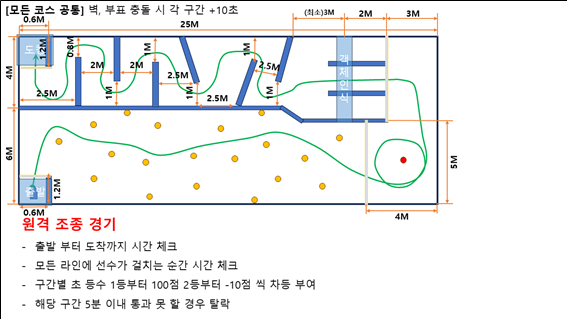
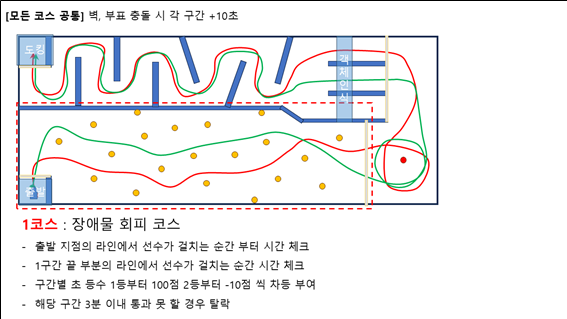
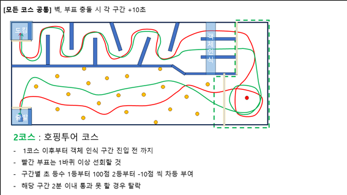
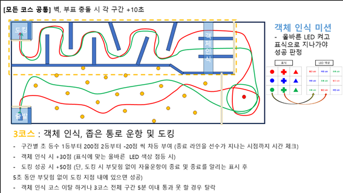

# KABOAT 2026

라이다·IMU·GPS를 이용하는 자율운항 보트 프로젝트입니다. 현재 배는 좌우 독립 추진기를 사용하며, 젯슨에서 센서와 주행 노드를 실행하고 아두이노에서 RC/AUTO 전환과 PWM 출력을 처리합니다.

실제 운용에 필요한 명령과 설정은 [정상 운용 기준](docs/BOAT_BASELINE_2026-10-30.md)에 정리했습니다.

## 현재 배 구성

| 항목 | 설정 |
|---|---|
| 선체 | 질량 25kg, 길이 1.1m, 폭 0.50m |
| 추진기 | 좌우 독립 제어, 중심 간격 0.32m |
| 센서 | GPS, VectorNav IMU, Velodyne 라이다. 카메라는 선택 사용 |
| 제어보드 | UNO R3, Blue Robotics Basic ESC 500 |
| 명령 표현 | 1000=최대 후진, 1500=정지, 2000=최대 직진 |
| 실제 ROS 입력 | 1100~1900, 중립 1500 |
| ESC 정지 출력 | 양쪽 1480µs |

새 젯슨 터미널은 ROS 환경이 자동 적용됩니다. 파일을 수정한 뒤에는 `cb`로 빌드하고, 센서와 주행 노드는 각각 실행합니다.

| 문서 | 내용 |
|---|---|
| [정상 운용 기준](docs/BOAT_BASELINE_2026-10-30.md) | 브링업·추진 시험·정지·초기화·주요 토픽 |
| [젯슨 필수 명령](deploy/jetson/README.md) | 자주 쓰는 실행 명령 |
| [아두이노 설정](firmware/README.md) | 배선·방향·중립·RC/AUTO 동작 |
| [기록과 분석](isv_water_trials/README_KO.md) | 센서 로그·GPS 지도·물리량 추정·MPC 검증 |
| [cb 사용법](docs/CB_USAGE.md) | 빌드와 환경 적용 |
| [프로젝트 구조](PROJECT_STRUCTURE.md) | 저장소와 젯슨의 파일 위치 |
| [기존 소스 백업](backups/README.md) | 2026-10-29 소스와 조사 기록 |

## 기존 대회 알고리즘

아래는 기존 대회 코드의 설계 내용입니다. 현재 배의 실행 방법과 설정은 위 운용 문서를 따릅니다.

센서는 라이다·IMU·GPS·카메라이며, 기존 설계는 서보모터와 추진기를 사용합니다. 도면의 위쪽을 y축·0°, 오른쪽을 x축·IMU 90°로 둡니다.

### 1코스: 목표 지점 이동과 장애물 회피

센서 데이터를 받아 매 프레임 조향 목표를 정합니다. 기본 목표는 첫 웨이포인트 방향이며, 가까운 장애물이 있으면 안전한 방향 중 GPS 목표에 가장 가까운 각도를 선택합니다.

라이다 전방 180°를 1°씩 나누고 각 구간의 평균 거리를 구합니다. 거리별 위험도 함수의 예는 $y=e^{-2.7x+1.5}$입니다. 위험도를 0~100으로 두고 임계값에 따라 위험 구간은 0, 안전 구간은 1로 표시합니다. 선체 폭을 고려해 위험 구간 양옆 5칸도 막은 뒤, 남은 방향 중 목표 각도와 가장 가까운 곳으로 조향합니다. 주변 5칸은 조정 가능한 예시값입니다.

첫 웨이포인트에 도착하면 IMU 기준 약 45° 우회전하여 보라색 부표를 찾습니다. 부표를 인식하거나 3초가 지나면 호핑으로 전환합니다.

### 2코스: 부표 호핑과 객체 인식

카메라는 선체 왼쪽 90°를 보고, 라이다는 전방 180°를 사용합니다. 공통 시야인 정면 0°~왼쪽 90°에서 영상의 픽셀 위치와 라이다 각도를 맞춥니다. 호핑에는 선체 기준 −90°~−180°의 영상 정보를 사용합니다.

1. IMU 135° 방향으로 이동하다가 부표가 보이면 부표 중앙을 선체 기준 −90°에 맞춥니다.
2. 부표가 −90°에 있으면 직진합니다.
3. 부표가 −110°에 있으면 좌회전 30°를 명령합니다. 기존 추진기 각도 예시는 60°입니다.

−110°와 회전 각도는 조정값입니다. 부표 오른쪽으로 한 바퀴 돌면서 IMU 0°를 두 번 통과하면 호핑을 마칩니다. 이어서 IMU −90° 방향으로 이동하며 목표 객체를 찾고, 객체가 카메라 중앙인 선체 기준 −90°에 올 때까지 진행합니다. 객체 색으로 LED를 켠 뒤, 세 갈림길을 포함하는 두 번째 웨이포인트까지 이동합니다. 당시 설계에서는 카메라 검출 실패에 대한 별도 예외 처리를 생략했습니다.

### 3코스: 도킹

진입 후 카메라를 끄고 라이다와 IMU로 이동합니다. 라이다 전방 180°를 1°씩 나눠 평균 거리를 구한 뒤 다음 순서로 조향합니다.

1. IMU 0°~−180°에 해당하는 진행 구역과 라이다 시야의 공통 범위를 구합니다.
2. 가장 먼 거리가 측정된 방향을 목표로 삼습니다.
3. 선택한 방향의 거리가 0.3m 이하가 되면 정지합니다.

정지 조건은 3코스 시작부터 적용하며 0.3m는 조정값입니다. 추진기 출력으로 선회 반경을 조절하고, 필요하면 1코스의 장애물 확장 처리와 선회 반경을 반영합니다.

### 당시 경기 규칙

| 항목 | 기준 |
|---|---|
| 벽·부표 충돌 | 구간별 +10초 |
| 1코스 제한 시간 | 3분, 초과 시 탈락 |
| 2코스 제한 시간 | 2분, 초과 시 탈락 |
| 3코스 제한 시간 | 5분, 초과 시 탈락 |
| 객체 인식 | +30점 |
| 도킹 성공 | +50점 |
