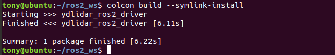
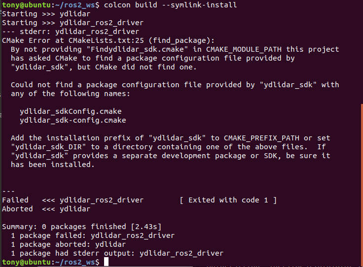
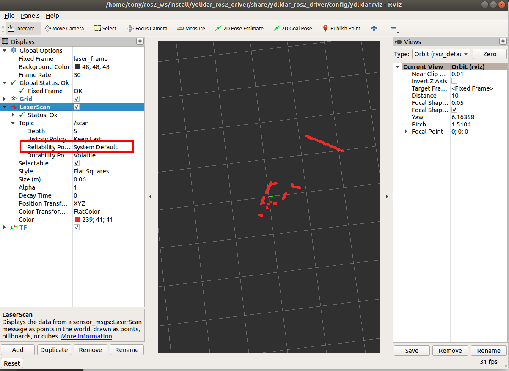

# YDLIDAR ROS 2 드라이버

YDLIDAR 장치를 연결해 LaserScan을 발행하는 ROS 2 패키지입니다. 현재 배에서는 Velodyne을 사용하며, 이 문서는 기존 YDLIDAR 패키지의 설치와 설정을 설명합니다.

## [ROS 2 설치](https://index.ros.org/doc/ros2/Installation)
[ubuntu](https://index.ros.org/doc/ros2/Installation/Dashing/Linux-Install-Debians/)

[windows](https://index.ros.org/doc/ros2/Installation/Dashing/Windows-Install-Binary/)

## ROS 2 작업 공간
[작업 공간 만들기](https://index.ros.org/doc/ros2/Tutorials/Colcon-Tutorial/#create-a-workspace)


## YDLidar SDK 설치

먼저 YDLidar-SDK를 설치합니다. SDK가 준비되어 있으면 드라이버 빌드로 진행합니다.

1. [YDLIDAR/YDLidar-SDK](https://github.com/YDLIDAR/YDLidar-SDK) 저장소를 내려받습니다.
2. SDK의 `README.md`에 따라 `build` 디렉터리에서 빌드·설치합니다.

## 드라이버 빌드와 환경 설정

1. 저장소를 작업 공간에 복제합니다.

   `git clone https://github.com/YDLIDAR/ydlidar_ros2_driver.git ydlidar_ros2_ws/src/ydlidar_ros2_driver`

2. 패키지를 빌드합니다.

   ```
   cd ydlidar_ros2_ws
   colcon build --symlink-install
   ```
   [colcon 설치 안내](https://index.ros.org/doc/ros2/Tutorials/Colcon-Tutorial/#install-colcon)

   

   아래 빌드 오류가 나오면 [YDLidar-SDK](https://github.com/YDLIDAR/YDLidar-SDK) 설치 상태를 확인합니다.

   

3. 작업 공간 환경을 적용합니다.

   `source ./install/setup.bash`

    새 터미널에서 자동 적용하려면 `.bashrc`에 등록합니다.
    ```
    echo "source ~/ydlidar_ros2_ws/install/setup.bash" >> ~/.bashrc
    source ~/.bashrc
    ```
4. ROS 환경 변수를 확인합니다.
    ```
    printenv | grep -i ROS
    ```

5. 필요하면 시리얼 포트 별칭을 설정합니다.
    ```
    chmod 0777 src/ydlidar_ros2_driver/startup/*
    sudo sh src/ydlidar_ros2_driver/startup/initenv.sh
    ```
    적용 후 라이다 USB를 다시 연결합니다.

## [라이다 설정](params/ydlidar.yaml)
```
ydlidar_ros2_driver_node:
  ros__parameters:
    port: /dev/ttyUSB0
    frame_id: laser_frame
    ignore_array: ""
    baudrate: 230400
    lidar_type: 1
    device_type: 0
    sample_rate: 9
    abnormal_check_count: 4
    resolution_fixed: true
    reversion: true
    inverted: true
    auto_reconnect: true
    isSingleChannel: false
    intensity: false
    support_motor_dtr: false
    angle_max: 180.0
    angle_min: -180.0
    range_max: 64.0
    range_min: 0.01
    frequency: 10.0
    invalid_range_is_inf: false
```

## 실행

launch 파일을 지정해 실행합니다.

 `ros2 launch ydlidar_ros2_driver [launch file].py`

1. 라이다 노드를 실행합니다.
   ```
   ros2 launch ydlidar_ros2_driver ydlidar_launch.py
   ```
2. RViz에서 확인합니다.
   ```
   ros2 launch ydlidar_ros2_driver ydlidar_launch_view.py
   ```
    

3. scan 데이터를 확인합니다.
   ```
   ros2 run ydlidar_ros2_driver ydlidar_ros2_driver_client
   # 또는
   ros2 topic echo /scan
   ```

### launch 파일

위치: `ydlidar_ros2_ws/src/ydlidar_ros2_driver/launch`

| launch 파일               | 기능                                                     |
| ------------------------- | ------------------------------------------------------------ |
| ydlidar.py         | 구버전 ROS 2 launch 형식, 기본 설정으로 연결하고 `scan` 발행 |
| ydlidar_launch.py         | `ydlidar.yaml` 설정으로 연결하고 `scan` 발행 |
| ydlidar_launch_view.py         | `ydlidar.yaml`로 연결하고 RViz 실행, `scan` 발행 |


## 발행 토픽

| 토픽                 | 형식                    | 설명                                      |
|----------------------|-------------------------|--------------------------------------------------|
| `scan`               | sensor_msgs/LaserScan   | 2D 라이다 스캔                |

## 서비스

| 서비스                 | 형식                    | 설명                                      |
|----------------------|-------------------------|--------------------------------------------------|
| `stop_scan`          | std_srvs::Empty   | 라이다 정지                                         |
| `start_scan`         | std_srvs::Empty   | 라이다 시작                                          |


## 내부 파라미터

launch 파일에서 아래 값을 지정합니다. 표와 YAML 예제의 범위 기본값은 서로 다르므로 실제 장치에 적용된 설정을 확인합니다.

| 파라미터 | 형식 | 설명                                                       |
| -------------- | ------- | ------------------------------------------------------------ |
| port | string | 시리얼 포트 또는 IP 주소. 예: `/dev/ttyUSB0`, `192.168.1.11`. 기본값 `/dev/ydlidar` |
| frame_id | string | 라이다 TF 프레임. 기본값 `laser_frame` |
| ignore_array | string | 제외할 각도 구간. 예: `-90, -80, 30, 40` |
| baudrate | int | 시리얼 속도 또는 네트워크 포트. 기본값 `230400` |
| lidar_type | int | 라이다 방식. 0=TYPE_TOF, 1=TYPE_TRIANGLE, 2=TYPE_TOF_NET. 기본값 `1` |
| device_type | int | 연결 방식. 0=SERIAL, 1=TCP, 2=UDP. 기본값 `0` |
| sample_rate | int | 샘플링 속도. 기본값 `9` |
| abnormal_check_count | int | 비정상 시작 데이터 확인 횟수. 기본값 `4` |
| fixed_resolution | bool | 각도 해상도 고정. 기본값 `true` |
| reversion | bool | 라이다 방향 반전. 기본값 `true` |
| inverted | bool | 스캔 방향. false=시계 방향, true=반시계 방향. 기본값 `true` |
| auto_reconnect | bool | 연결 복구 시 자동 재연결. 기본값 `true` |
| isSingleChannel | bool | 단일 채널 사용 여부. 기본값 `false` |
| intensity | bool | 반사 강도 사용 여부. 원문 기준 G2는 true, 기본값 `false` |
| support_motor_dtr | bool | 시리얼 DTR로 모터 시작·정지. 기본값 `false` |
| angle_min | float | 최소 유효 각도. 기본값 `-180` |
| angle_max | float | 최대 유효 각도. 기본값 `180` |
| range_min | float | 최소 유효 거리. 기본값 `0.1` |
| range_max | float | 최대 유효 거리. 기본값 `16.0` |
| frequency | float | 스캔 주파수. 기본값 `10.0` |
| invalid_range_is_inf | bool | 유효하지 않은 거리 표시. true=inf, false=0.0. 기본값 `false` |

추가 설명은 [파라미터 상세](details.md)를 참고합니다.

## 제조사 문의

제품 문의: [EAI 연락처](http://www.ydlidar.cn/cn/contact)
